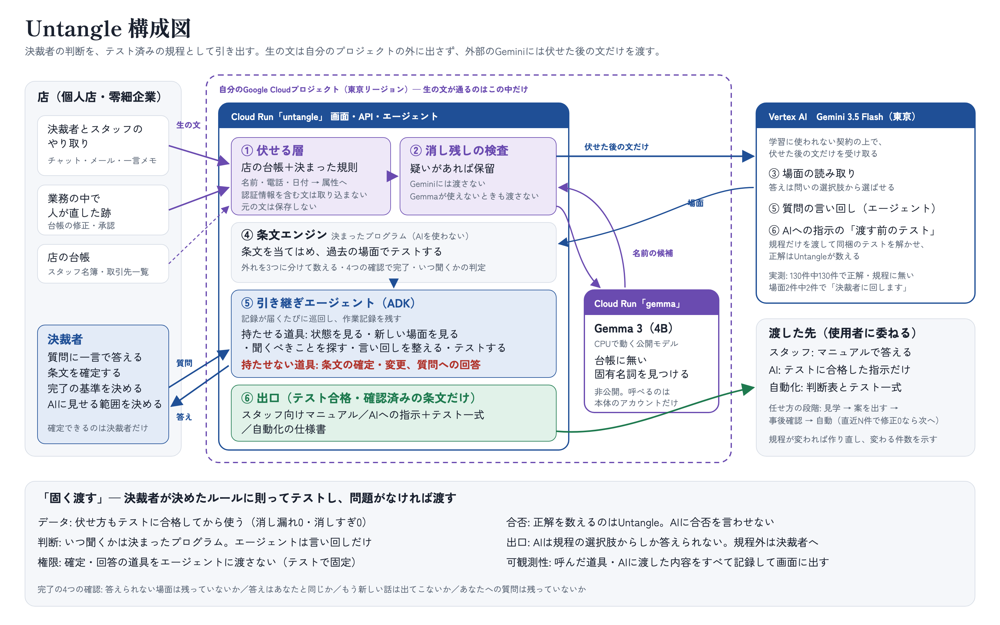

# Untangle

個人店・零細企業の決裁者が培ってきた判断を、信頼のおける形で引き出し、共有知にするサービス。
第5回 Agentic AI Hackathon with Google Cloud 提出作品（開発中）。



- 公開URL（デモ・架空データ）: https://untangle-63500257813.asia-northeast1.run.app
- 説明文（提出用の下書き）: [docs/submission.md](docs/submission.md)

## 流れ

1. 普段のやり取り（決裁者と従業員のチャット）と、業務の中で人が直した跡を送る
2. サーバーの中で個人情報と秘密を伏せてから「場面」にする（元の文は保存しない）
3. エージェントがテーマ・問いに振り分け、食い違いや答えられない場面を見つけて決裁者に聞き返す
4. 決裁者の答えで条文が育ち、過去の場面に当て直してテストする（合否を数えるのは決まったプログラム）
5. 4つの確認がそろったら規程の版を出し、スタッフ向け・AI向け・自動化向けの3つの形で渡す

## 開発

```
python3.12 -m venv .venv && .venv/bin/pip install -e '.[dev]'
.venv/bin/python -m pytest
```

デモ用データはすべて架空です（`untangle/seed.py`）。
